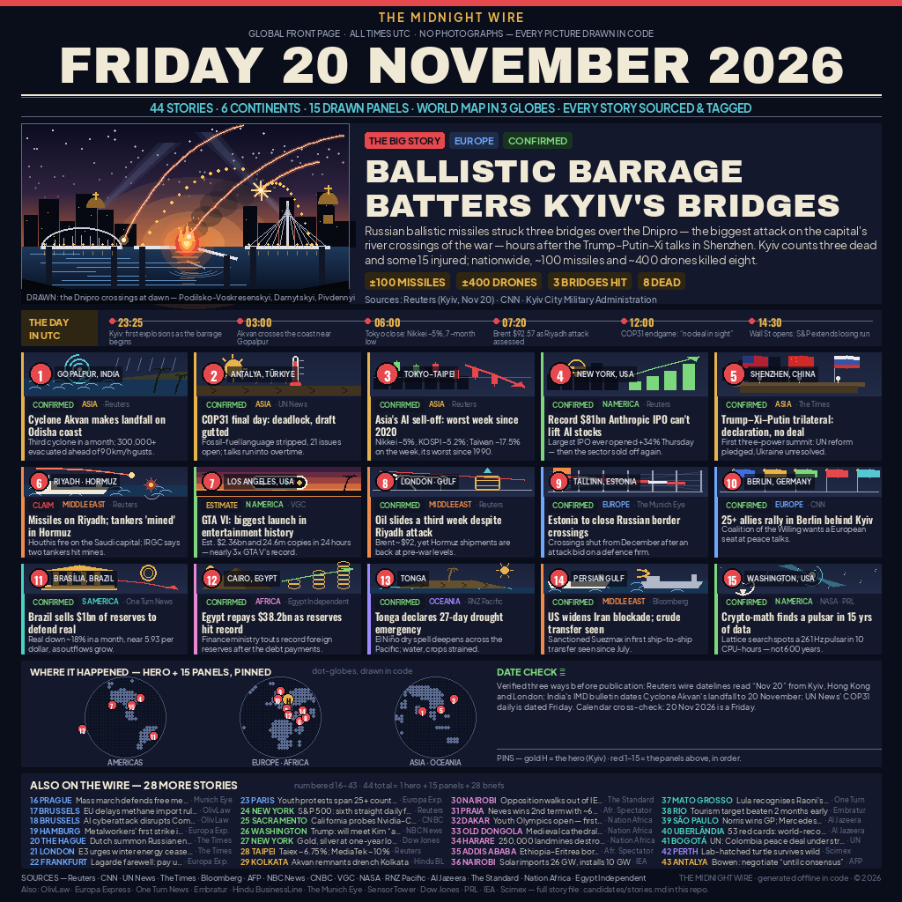

# The Midnight Wire — Friday 20 November 2026

[](https://make.fun/bounty/news-image-20261120?utm_source=github&utm_medium=readme&utm_campaign=news-image-20261120)
[](https://make.fun/bounty/news-image-20261120?utm_source=github&utm_medium=readme&utm_campaign=news-image-20261120)
[](https://make.fun/bounty/news-image-20261120?utm_source=github&utm_medium=readme&utm_campaign=news-image-20261120)

One image that sums up the world's news on **Friday 20 November 2026**: a full
broadsheet front page, drawn entirely in code — no photographs, no stock art.



## What's on the page

- **44 stories across 6 continents**, every one verified against the named
  outlet on the day (wire services and major papers; full list in
  [`candidates/stories.md`](candidates/stories.md)).
- **The big story:** Russian ballistic missiles strike three bridges over the
  Dnipro in Kyiv — the biggest attack on the capital's river crossings of the
  war — hours after the Trump–Putin–Xi trilateral in Shenzhen. The hero
  illustration (the three crossings at dawn, one span burning) is drawn
  procedurally, like every other picture on the page.
- **15 numbered panels**, each with its own small drawn illustration, region
  tag, proof tag and source: Cyclone Akvan's landfall in India, COP31's
  final-day deadlock in Antalya, Asia's AI stock rout, Anthropic's record
  $81bn IPO, missiles on Riyadh and tankers in Hormuz, GTA VI's record
  launch day, Estonia closing its Russian border, Brazil's $1bn defence of
  the real, Egypt's $38.2bn debt repayment, Tonga's drought emergency, the
  widened Iran blockade, and a pulsar found by cryptography maths.
- **A UTC timeline rail** — the day in six timestamps, from the first
  explosions in Kyiv (23:25 UTC) to Wall Street's open (14:30 UTC).
- **A world map drawn as three dot-globes** (Americas · Europe–Africa ·
  Asia–Oceania) with numbered pins matching the hero and panels.
- **28 further briefs** in the "Also on the Wire" band, each with place and
  source, plus a **DATE CHECK** box showing how the date was verified three
  ways before publication.
- **Proof tags, honestly applied:** `CONFIRMED` = wire-verified ·
  `CLAIM` = one side's statement (the IRGC tanker claim) ·
  `ESTIMATE` = modelled figure (Sensor Tower's GTA VI launch estimates).

Continent split: Europe 11 · Asia (incl. Middle East) 10 · Africa 8 ·
North America 7 · South America 6 · Oceania 2.

## How it was made

The front page was researched region by region on the day, curated into
`candidates/stories.md`, then rendered by a Python/Pillow generator
(`candidates/build_frontpage.py`) that draws the masthead, hero scene,
15 panel illustrations, timeline, dot-globe map and briefs band onto a
single 1024×1024 canvas. Display type is Archivo Black with Oswald panel
headlines and Plus Jakarta Sans body text.

## Running the hand-in program

```sh
python3 main.py            # writes $MAKEFUN_OUTPUT_DIR/entry.png (default /output)
```

`main.py` uses only the Python standard library: it copies the shipped
`entry.png` to the output directory, byte for byte.

## License

MIT — see [LICENSE](LICENSE).
